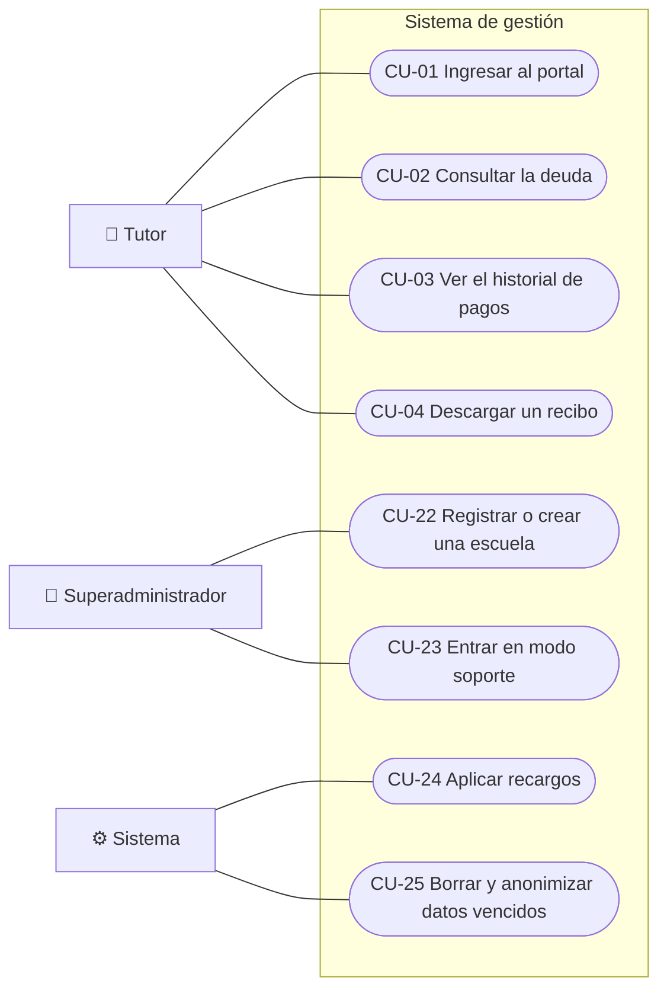
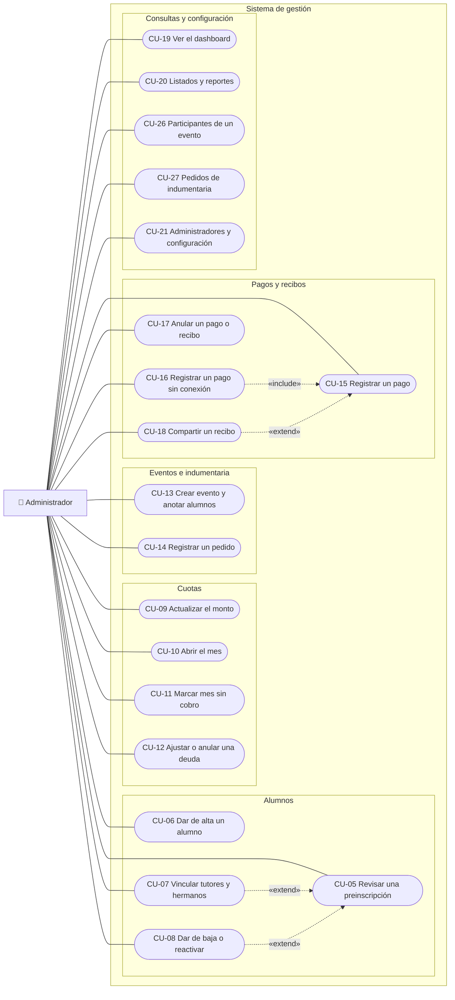

# Casos de uso

Casos de uso de la v1.0 por actor. Los marcados con ⭐ son los principales: se detallan con el formato completo y sirven para validar el [modelo de datos](../04-modelo-de-datos/index.md), porque cada paso indica qué entidades lee o escribe. Los demás se detallarán al desarrollar su módulo ([propuesta de módulos](modulos.md)).

## Actores

| Actor | Descripción |
|---|---|
| Tutor | Madre, padre o adulto responsable. Consulta desde el portal de familias. |
| Administrador | Usuario de la escuela con todos los permisos de gestión (RN-37 a RN-39). |
| Superadministrador | Responsable de la plataforma (RN-43). |
| Sistema | Procesos automáticos. |

## Lista de casos de uso

### Tutor

| ID | Caso de uso | Requisitos | Reglas |
|---|---|---|---|
| CU-01 | Ingresar al portal y cambiar la contraseña inicial | RF-02, RF-14 | RN-45 a RN-47 |
| CU-02 ⭐ | Consultar la deuda de sus hijos por concepto | RF-14 | RN-48, RN-60 |
| CU-03 | Ver el historial de pagos | RF-14 | RN-48 |
| CU-04 | Descargar un recibo | RF-13, RF-14 | RN-24 |

### Administrador

| ID | Caso de uso | Requisitos | Reglas |
|---|---|---|---|
| CU-05 ⭐ | Revisar y aprobar o rechazar una preinscripción | RF-05 a RF-08 | RN-25 a RN-29 |
| CU-06 | Dar de alta un alumno directamente | RF-09 | RN-28 |
| CU-07 | Vincular tutores y hermanos (grupo familiar) | RF-09, RF-10 | RN-06, RN-29 |
| CU-08 | Dar de baja o reactivar a un alumno | RF-09 | RN-31 a RN-35, RN-63 |
| CU-09 | Actualizar el monto de la cuota | RF-11 | RN-01, RN-02 |
| CU-10 ⭐ | Abrir el mes y anular la apertura | RF-11 | RN-03, RN-05, RN-06, RN-15, RN-61 |
| CU-11 | Marcar un mes como sin cobro | RF-11 | RN-04 |
| CU-12 | Ajustar, condonar o anular una deuda | RF-11 | RN-10, RN-33 |
| CU-13 | Crear un evento y anotar alumnos | RF-19 | RN-55, RN-56 |
| CU-14 | Registrar un pedido de indumentaria | RF-20 | RN-58 |
| CU-15 ⭐ | Registrar un pago | RF-12, RF-13 | RN-11 a RN-16, RN-19, RN-62 |
| CU-16 ⭐ | Registrar un pago sin conexión y sincronizarlo | RF-12, RF-17 | RN-17 |
| CU-17 | Anular un pago o un recibo | RF-12, RF-13 | RN-18, RN-23 |
| CU-18 | Compartir un recibo por WhatsApp | RF-13 | RN-24 |
| CU-19 | Ver el dashboard | RF-15 | RN-49, RN-50 |
| CU-20 | Sacar listados y reportes (por categoría, deudores, recaudación, altas y bajas) | RF-04, RF-15 | RN-51 a RN-54 |
| CU-21 | Gestionar otros administradores y la configuración de la escuela | RF-01 a RF-03 | RN-38 |
| CU-26 | Ver los participantes de un evento | RF-15, RF-19 | RN-64 |
| CU-27 | Ver los pedidos de indumentaria | RF-15, RF-20 | RN-64 |

### Superadministrador

| ID | Caso de uso | Requisitos | Reglas |
|---|---|---|---|
| CU-22 | Registrar o crear una escuela | RF-01, RF-18 | RN-41 |
| CU-23 | Entrar a una escuela en modo soporte | RF-02, RF-16 | RN-43 |

### Sistema

| ID | Caso de uso | Requisitos | Reglas |
|---|---|---|---|
| CU-24 | Aplicar recargos al vencer una cuota | RF-11 | RN-08, RN-09 |
| CU-25 | Borrar preinscripciones rechazadas a los 30 días y anonimizar escuelas dadas de baja | RF-07 | RN-27, RN-42 |

La auditoría (RF-16) no es un caso de uso propio: cada caso que modifica datos la registra como parte de su flujo.

## Diagramas de casos de uso

### Tutor, superadministrador y sistema

### Administrador

**Cómo leerlos:** cada actor se une con línea continua a los casos que inicia. Una flecha punteada **«include»** indica que un caso siempre ejecuta al otro: el pago sin conexión, al sincronizarse, ejecuta el registro de un pago. Una flecha punteada **«extend»** indica que un caso puede agregarse a otro de forma opcional: al revisar una preinscripción, el administrador puede vincular hermanos o reactivar a un alumno existente, y después de registrar un pago puede compartir el recibo.

## Casos detallados

Cada caso detallado sigue esta plantilla:

| Campo | Contenido |
|---|---|
| Descripción | Qué logra el actor, en una oración. |
| Actor principal | Quién inicia el caso. |
| Disparador | Qué hace que el caso empiece. |
| Precondiciones | Qué tiene que cumplirse antes de empezar. |
| Flujo principal | Los pasos cuando todo sale bien. Cada paso indica, en cursiva, qué entidades del modelo lee o escribe. |
| Flujos alternativos | Otros caminos válidos. Se numeran según el paso donde se desvían (2a es una alternativa al paso 2). |
| Excepciones | Errores o situaciones que impiden terminar el caso. |
| Postcondiciones | Cómo queda el sistema al terminar. |
| Requisitos y reglas | RF, RN y ADR relacionados. |

### CU-02 – Consultar la deuda de sus hijos por concepto

| Campo | Contenido |
|---|---|
| Descripción | El tutor ve cuánto deben sus alumnos, separado en cuotas, eventos e indumentaria. |
| Actor principal | Tutor. |
| Disparador | El tutor abre la sección de deuda del portal. |
| Precondiciones | El tutor ingresó al portal (CU-01) y está vinculado al menos a un alumno. |
| Requisitos y reglas | RF-14; RN-45, RN-48, RN-60; ADR-006. |

**Flujo principal**

1. El sistema muestra los alumnos vinculados al tutor, de cualquier escuela. *Lee: usuario, tutor, vínculo tutor–alumno, alumno.*
2. Para cada alumno muestra la deuda separada en **cuotas**, **eventos** e **indumentaria**, con el total. *Lee: cuota, recargo, ajuste, inscripción a evento, pedido, imputación.*
3. El tutor abre un concepto y ve el detalle: cada cuota con su mes, vencimiento, recargo y saldo; cada evento o pedido con lo pagado y el saldo. *Lee: mes, cuota, recargo, inscripción a evento, evento, pedido, imputación.*

**Flujos alternativos**

- 2a. El alumno no tiene deuda: se muestra "al día".
- 2b. El alumno tiene saldo a favor: se muestra aparte, debajo de la deuda. *Lee: pago, imputación.*
- 2c. Hay pagos pendientes de sincronizar (CU-16): no se muestran hasta que el servidor los confirma.

**Excepciones**

- E1. El tutor no tiene alumnos vinculados: el sistema muestra un mensaje y le sugiere comunicarse con la escuela.
- E2. No hay conexión: la aplicación muestra los datos de la última sincronización, con su fecha y hora.

**Postcondiciones**

- Ninguna: es una consulta y no modifica datos. Las cuotas, recargos y deudas anuladas no suman, y el tutor solo ve a sus alumnos.

### CU-05 – Revisar y aprobar o rechazar una preinscripción

| Campo | Contenido |
|---|---|
| Descripción | El administrador revisa una solicitud recibida por el formulario y la convierte en alumno o la rechaza. |
| Actor principal | Administrador. |
| Disparador | Ingresan preinscripciones nuevas desde la planilla del formulario y el administrador abre la lista de pendientes. |
| Precondiciones | El administrador ingresó a su escuela. Hay al menos una preinscripción pendiente. |
| Requisitos y reglas | RF-05 a RF-08, RF-18; RN-25 a RN-29, RN-34, RN-44; ADR-002. |

**Flujo principal**

1. El administrador abre la lista de preinscripciones pendientes. *Lee: preinscripción.*
2. Elige una y el sistema busca duplicados por DNI. *Lee: tutor (en toda la plataforma), alumno (en la escuela), otras preinscripciones pendientes.*
3. El administrador revisa los datos y, si hace falta, los corrige.
4. Aprueba la preinscripción.
5. El sistema crea el alumno, sus datos de salud y su primera permanencia, y crea o vincula los tutores. *Escribe: alumno, datos de salud, permanencia, tutor, vínculo tutor–alumno, usuario del tutor.*
6. El sistema borra los datos personales de la preinscripción y deja el estado, la fecha, quién la aprobó y el alumno creado. *Escribe: preinscripción, auditoría.*
7. El administrador comparte el acceso al portal por WhatsApp, o el sistema lo envía por mail si el tutor no tiene WhatsApp.

**Flujos alternativos**

- 2a. El tutor ya existe: se vincula en lugar de crearlo.
- 2b. El alumno ya existe en la escuela: el sistema ofrece reactivarlo (CU-08) en lugar de crearlo.
- 2c. Hay otra preinscripción pendiente con el mismo DNI: el sistema avisa y el administrador puede rechazar la repetida.
- 4a. El administrador la rechaza: queda rechazada, con quién y cuándo, y sus datos se borran a los 30 días (CU-25). *Escribe: preinscripción, auditoría.*
- 5a. El alumno tiene un hermano en la escuela: el administrador lo vincula al grupo familiar (CU-07).

**Excepciones**

- E1. Otro administrador ya resolvió la preinscripción: el sistema avisa y muestra su estado actual.
- E2. Falla cualquier paso entre 5 y 6: no se guarda nada y la preinscripción sigue pendiente.

**Postcondiciones**

- Si se aprobó: el alumno está activo, con su permanencia abierta y sus tutores vinculados. La preinscripción queda aprobada, sin datos personales, y apunta al alumno creado.
- Si se rechazó: la preinscripción queda rechazada y sus datos se borran a los 30 días.
- En los dos casos queda registrado quién la resolvió y cuándo.

### CU-10 – Abrir el mes y anular la apertura

| Campo | Contenido |
|---|---|
| Descripción | El administrador confirma las condiciones del mes y el sistema genera las cuotas de los alumnos activos. |
| Actor principal | Administrador. |
| Disparador | Empieza un mes y el dashboard avisa que todavía no se abrió, o el administrador lo elige desde el menú. |
| Precondiciones | El administrador ingresó a su escuela. El mes no está abierto ni marcado como sin cobro. La escuela tiene un monto de cuota vigente. |
| Requisitos y reglas | RF-11, RF-16; RN-01 a RN-06, RN-08, RN-09, RN-15, RN-31, RN-49, RN-61. |

**Flujo principal**

1. El administrador elige "Abrir mes". El sistema propone el monto vigente, el vencimiento sugerido y los recargos sugeridos. *Lee: monto de cuota, configuración.*
2. El administrador confirma o modifica el monto, la fecha de vencimiento y los escalones de recargo.
3. El sistema crea el mes y una cuota por cada alumno activo, con el monto y el descuento por hermanos si corresponde. *Escribe: mes, cuota. Lee: alumno, permanencia, grupo familiar, configuración.*
4. El sistema imputa los saldos a favor de cada alumno a su nueva cuota. *Lee: pago. Escribe: imputación.*
5. El sistema registra la apertura. *Escribe: auditoría.*

**Flujos alternativos**

- 2a. Si el administrador cambió el monto, el sistema pregunta si es un nuevo monto vigente (CU-09). *Escribe: monto de cuota.*
- 3a. Un alumno se dio de alta a mitad de mes: el administrador ajusta su cuota con el proporcional (CU-12). *Escribe: ajuste.*

**Flujo alternativo B: anular la apertura**

1. El administrador elige "Anular apertura" e indica el motivo.
2. El sistema verifica que ninguna cuota del mes tenga pagos registrados después de la apertura. *Lee: imputación.*
3. Anula el mes y sus cuotas, y revierte las imputaciones de saldo a favor. *Escribe: mes, cuota, imputación, auditoría.*
4. El administrador puede volver a abrir el mes.

**Excepciones**

- E1. No hay alumnos activos: el sistema avisa que no se generará ninguna cuota y pide confirmar.
- E2. Otro administrador abrió el mismo mes al mismo tiempo: el sistema rechaza la segunda apertura y avisa que el mes ya está abierto. Nunca se generan dos cuotas del mismo mes para un alumno.
- E3. En la anulación, alguna cuota tiene pagos: el sistema no permite anular y sugiere corregir con ajustes (CU-12).

**Postcondiciones**

- El mes queda abierto con su monto, vencimiento y recargos congelados.
- Cada alumno activo tiene una cuota del mes, con el descuento que le correspondía, y los saldos a favor quedaron imputados.
- El dashboard deja de avisar que el mes no se abrió.
- Si se anuló la apertura, el mes y sus cuotas quedan anulados (no se borran) y los saldos a favor vuelven a estar disponibles.

### CU-15 – Registrar un pago

| Campo | Contenido |
|---|---|
| Descripción | El administrador registra un ingreso de dinero, lo reparte entre alumnos y conceptos, y el sistema emite los recibos. |
| Actor principal | Administrador. |
| Disparador | Una familia paga en efectivo o envía el comprobante de una transferencia. |
| Precondiciones | El administrador ingresó a su escuela y tiene conexión (sin conexión, ver CU-16). Verificó el ingreso del dinero. La forma de pago está habilitada en la escuela. |
| Requisitos y reglas | RF-12, RF-13, RF-16; RN-11 a RN-16, RN-19 a RN-21, RN-60, RN-62; ADR-003, ADR-009. |

**Flujo principal**

1. El administrador elige la forma de pago, el importe total, la fecha de pago (por defecto, hoy) y una descripción opcional. *Lee: forma de pago de la escuela.*
2. Elige los alumnos y, para cada uno, el concepto y el importe: cuotas, un evento o un pedido. El sistema muestra la deuda de cada concepto. *Lee: cuota, recargo, inscripción a evento, pedido, imputación.*
3. El sistema controla que la suma de las partes sea igual al importe total.
4. El sistema verifica si hay una operación con el mismo importe, la misma fecha y los mismos alumnos, y si la hay, pregunta si ya se cargó. *Lee: operación, pago.*
5. El administrador confirma. En una sola transacción, el sistema:
    1. crea la operación y un pago por cada parte; *Escribe: operación, pago.*
    2. imputa cada pago: en cuotas, de la deuda más antigua a la más nueva; en eventos y pedidos, a esa deuda; lo que sobra queda como saldo a favor; *Escribe: imputación.*
    3. emite un recibo por pago con el siguiente número de la escuela; *Escribe: recibo, numerador.*
    4. registra la auditoría. *Escribe: auditoría.*
6. El sistema muestra los recibos emitidos.

**Flujos alternativos**

- 1a. La fecha de pago es anterior al vencimiento de una cuota que ya tiene recargo: el sistema anula el recargo o lo recalcula (RN-62). *Escribe: recargo.*
- 2a. Un solo alumno y un solo concepto: el paso 2 se completa solo con el importe total.
- 4a. El administrador indica que ya estaba cargada: se cancela el registro.
- 6a. El administrador comparte los recibos por WhatsApp (CU-18).

**Excepciones**

- E1. La suma de las partes no coincide con el importe total: el sistema no deja confirmar hasta que coincidan.
- E2. Falla cualquier paso de la transacción: no se guarda nada y el número de recibo no se consume (ADR-009).
- E3. Se pierde la conexión antes de confirmar: el administrador puede guardarlo como pago sin conexión (CU-16).

**Postcondiciones**

- Quedan registrados la operación, un pago por cada parte y sus imputaciones. La deuda de cada concepto bajó, y lo que sobró es saldo a favor del alumno.
- Cada pago tiene su recibo, con números correlativos y sin huecos dentro de la escuela.
- Queda registrado qué administrador hizo el pago y cuándo.

### CU-16 – Registrar un pago sin conexión y sincronizarlo

| Campo | Contenido |
|---|---|
| Descripción | El administrador registra un pago sin internet y el servidor lo confirma cuando vuelve la conexión. |
| Actor principal | Administrador. |
| Disparador | El administrador necesita registrar un pago y no tiene conexión. |
| Precondiciones | La aplicación está instalada en el dispositivo y el administrador ya ingresó y sincronizó los datos de su escuela con conexión. |
| Requisitos y reglas | RF-12, RF-17; RN-12, RN-17; ADR-003. |

**Flujo principal**

1. Sin conexión, el administrador registra el pago con los mismos datos que en CU-15. La aplicación muestra la deuda de la última sincronización.
2. La aplicación guarda la operación en el dispositivo como **pendiente de sincronizar**, con un identificador generado en el dispositivo. Puede mostrar un comprobante provisorio sin número.
3. Cuando vuelve la conexión, la aplicación envía las operaciones pendientes.
4. El servidor verifica que el identificador no se haya recibido antes. *Lee: operación.*
5. El servidor ejecuta los pasos 4 y 5 de CU-15 con la fecha de pago original y marca la operación como cargada sin conexión. *Escribe: operación, pago, imputación, recibo, numerador, auditoría.*
6. La aplicación muestra los recibos definitivos.

**Flujos alternativos**

- 4a. El identificador ya se había recibido (doble envío): el servidor responde con la operación existente y no la duplica.
- 5a. El servidor detecta un posible duplicado (RN-12): la operación queda **en espera** hasta que el administrador la confirme o la descarte.
- 5b. La deuda cambió mientras tanto (por ejemplo, otro administrador cobró lo mismo): el sistema imputa a lo que quede pendiente y lo que sobra queda como saldo a favor. El administrador ve el resultado y puede anular (CU-17).

**Excepciones**

- E1. Al sincronizar, la sesión del administrador venció: la aplicación le pide ingresar de nuevo y las operaciones siguen guardadas en el dispositivo.
- E2. Mientras haya operaciones pendientes, la aplicación lo avisa para que el administrador no cierre la sesión ni borre los datos del navegador, porque se perderían.

**Postcondiciones**

- Antes de sincronizar: el servidor no cambia, la deuda no se actualiza y no hay recibo numerado.
- Después de sincronizar: lo mismo que en CU-15, con la operación marcada como cargada sin conexión y la fecha de pago original.

## Validación del modelo

Al recorrer los casos detallados se confirmó que el modelo conceptual tiene las entidades necesarias. Se suman dos detalles para el DER:

- **Operación:** un identificador generado en el dispositivo (CU-16, paso 2) y un estado "en espera" para los posibles duplicados (CU-16, 5a).
- **Preinscripción:** quién la revisó y cuándo, y el alumno creado, que quedan después de borrar los datos personales (CU-05, paso 6).
