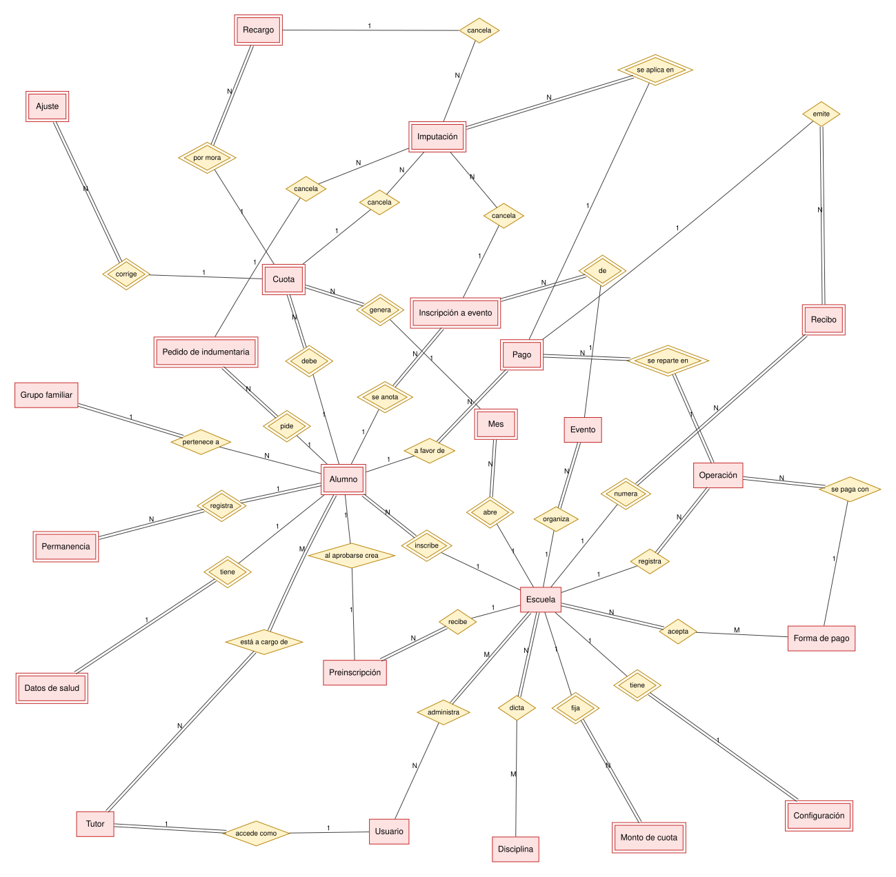
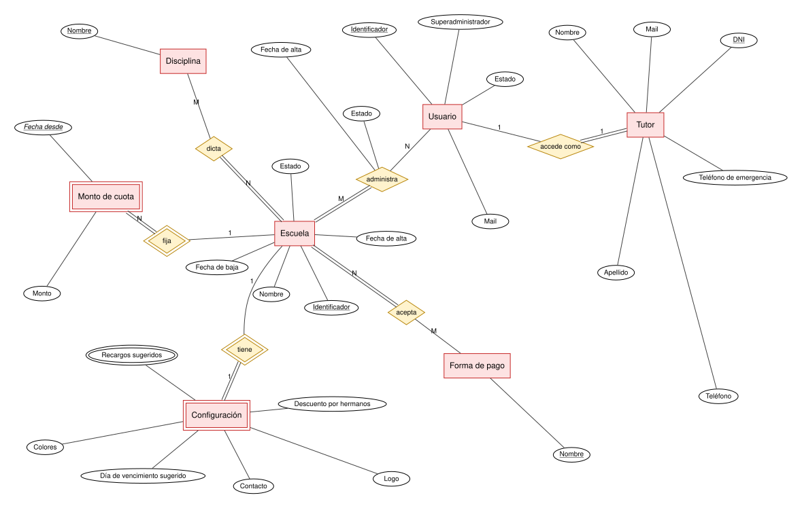
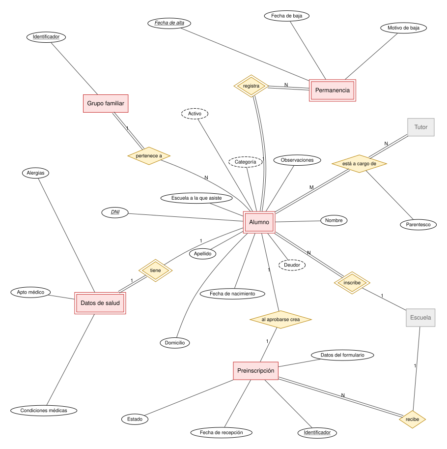
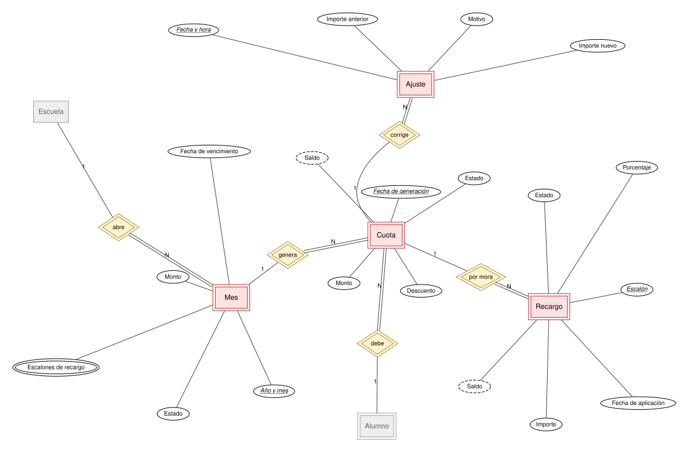
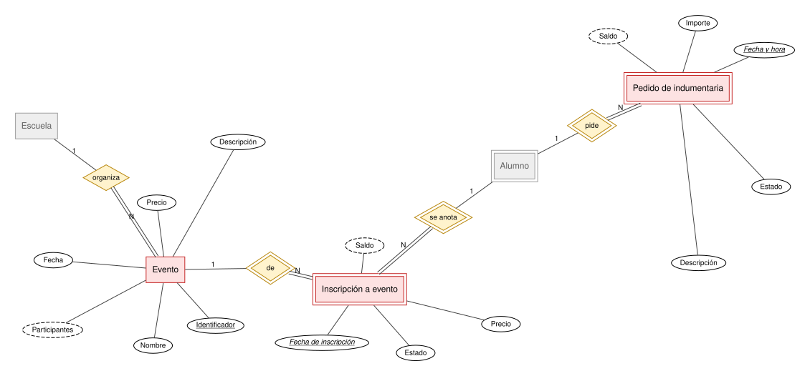
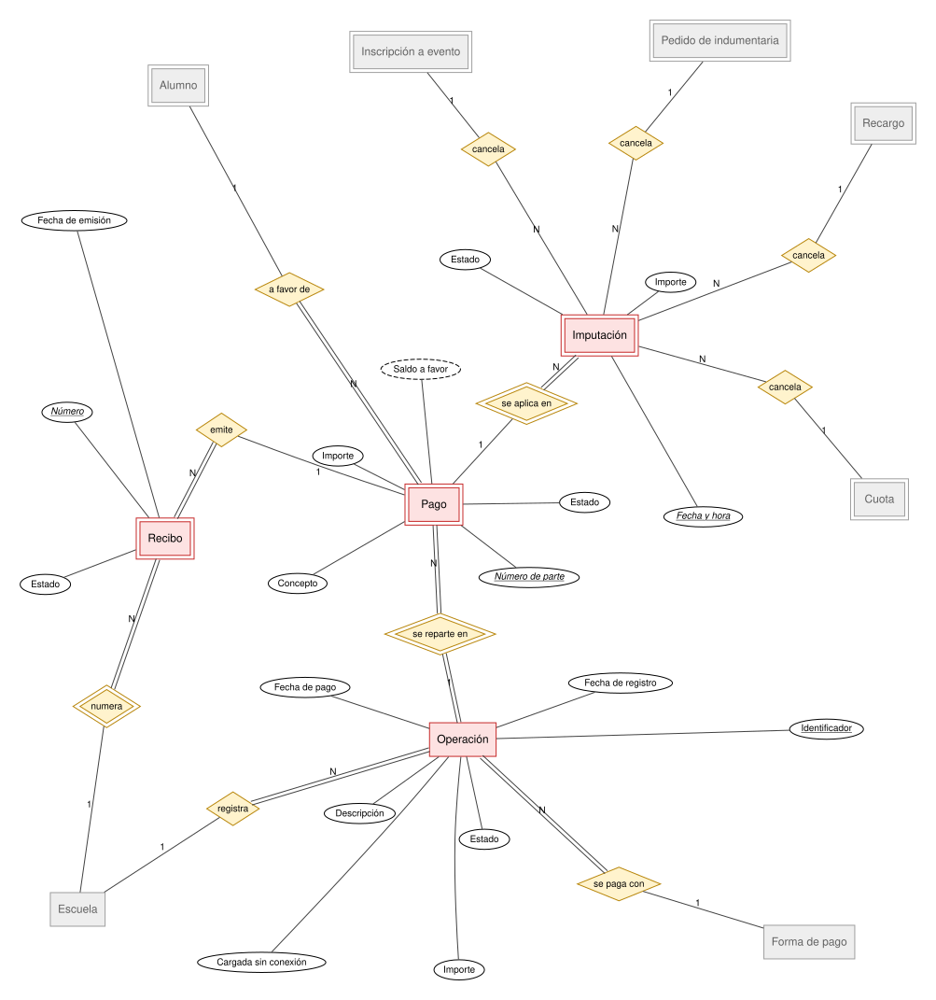

# DER conceptual (notación de Chen)

Este documento presenta el modelo conceptual de la v1.0 como Diagrama Entidad-Relación (DER) en notación de Chen. Parte del [modelo conceptual revisado](index.md), de las [reglas de negocio](../03-reglas-de-negocio/index.md) y de los [casos de uso](../02-requisitos/casos-de-uso.md).

Representa entidades, atributos, relaciones, cardinalidades y participación. No incluye decisiones del modelo lógico o físico, como claves foráneas, tablas intermedias, tipos de datos o la columna de escuela en cada tabla ([ADR-006](../adr/0006-aislamiento-multiescuela.md)). Esas decisiones corresponden al modelo relacional, que es el paso siguiente.

## 1. Diagramas

| Diagrama | Código | Imagen |
|---|---|---|
| DER completo (sin atributos) | [der-completo.dot](der/der-completo.dot) | [der-completo.svg](der/img/der-completo.svg) |
| Vista 1 – Escuelas y usuarios | [1-escuelas-y-usuarios.dot](der/1-escuelas-y-usuarios.dot) | [1-escuelas-y-usuarios.svg](der/img/1-escuelas-y-usuarios.svg) |
| Vista 2 – Alumnos y familias | [2-alumnos-y-familias.dot](der/2-alumnos-y-familias.dot) | [2-alumnos-y-familias.svg](der/img/2-alumnos-y-familias.svg) |
| Vista 3 – Cuotas | [3-cuotas.dot](der/3-cuotas.dot) | [3-cuotas.svg](der/img/3-cuotas.svg) |
| Vista 4 – Eventos e indumentaria | [4-eventos-e-indumentaria.dot](der/4-eventos-e-indumentaria.dot) | [4-eventos-e-indumentaria.svg](der/img/4-eventos-e-indumentaria.svg) |
| Vista 5 – Pagos y recibos | [5-pagos-y-recibos.dot](der/5-pagos-y-recibos.dot) | [5-pagos-y-recibos.svg](der/img/5-pagos-y-recibos.svg) |

El DER completo muestra todas las entidades y relaciones sin atributos, para ver el modelo entero de un vistazo. Cada vista muestra una parte con sus atributos. En las vistas, las entidades en gris pertenecen a otra vista y aparecen solo para mostrar la relación.

Los diagramas están escritos en el lenguaje de Graphviz (archivos `.dot`). Si el modelo cambia, se edita el `.dot` y se vuelve a generar la imagen:

```bash
neato -Tsvg der/3-cuotas.dot -o der/img/3-cuotas.svg
```

### DER completo



### Notación

| Símbolo | Significado |
|---|---|
| Rectángulo | Entidad |
| Rectángulo doble | Entidad débil |
| Rombo | Relación |
| Rombo doble | Relación identificadora (de una entidad débil) |
| Óvalo | Atributo |
| Óvalo con nombre subrayado | Clave |
| Óvalo con nombre subrayado en cursiva | Discriminador de una entidad débil |
| Óvalo punteado | Atributo derivado (se calcula, no se guarda) |
| Óvalo doble | Atributo multivaluado |
| Línea doble | Participación total: toda instancia de la entidad participa en la relación |
| Línea simple | Participación parcial |
| 1, N, M sobre la línea | Cardinalidad |

### Vista 1 – Escuelas y usuarios



### Vista 2 – Alumnos y familias



### Vista 3 – Cuotas



### Vista 4 – Eventos e indumentaria



### Vista 5 – Pagos y recibos



## 2. Entidades y atributos

### Escuelas y usuarios

#### Escuela

Institución que usa la plataforma (RN-40).

| Atributo | Observación |
|---|---|
| **Identificador** | Clave. El nombre no sirve como clave porque puede repetirse o cambiar. |
| Nombre | |
| Estado | Activa o dada de baja (RN-42). |
| Fecha de alta | RN-41 |
| Fecha de baja | Vacía mientras está activa. Inicia el plazo de 6 meses para la anonimización (RN-42). |

#### Configuración (entidad débil de Escuela)

Parámetros de cada escuela. Se identifica por su escuela, porque cada escuela tiene una sola configuración.

| Atributo | Observación |
|---|---|
| Logo | Archivo de imagen. |
| Colores | |
| Contacto | Teléfono, mail y dirección. |
| Día de vencimiento sugerido | RN-05 |
| Recargos sugeridos | Multivaluado: hasta dos escalones, cada uno con su porcentaje y su día (RN-08, RN-09). |
| Descuento por hermanos | Porcentaje (RN-06). |

#### Disciplina

Deporte. Catálogo común a toda la plataforma ([ADR-004](../adr/0004-plataforma-multidisciplina.md)).

| Atributo | Observación |
|---|---|
| **Nombre** | Clave. |

#### Forma de pago

Catálogo común; cada escuela habilita las suyas (RN-11).

| Atributo | Observación |
|---|---|
| **Nombre** | Clave (efectivo, transferencia). |

#### Monto de cuota (entidad débil de Escuela)

Historial de montos de la cuota (RN-01, RN-02).

| Atributo | Observación |
|---|---|
| *Fecha desde* | Discriminador: una escuela no puede tener dos montos con la misma fecha desde. |
| Monto | |

#### Usuario

Cuenta de acceso. Un mismo usuario puede ser superadministrador, administrador de una o más escuelas y tutor (RN-37 a RN-47).

| Atributo | Observación |
|---|---|
| **Identificador** | Clave. Los administradores ingresan con su mail y los tutores con su DNI, por eso ninguno de los dos sirve solo como clave. |
| Mail | Obligatorio para los administradores, que deben verificarlo (RN-41). |
| Estado | Activo o dado de baja (RN-38). |
| Superadministrador | Sí o no (RN-43). |

#### Tutor

Persona adulta responsable de uno o más alumnos. Es común a toda la plataforma (RN-29, RN-45).

| Atributo | Observación |
|---|---|
| **DNI** | Clave: identifica al tutor en todas las escuelas (RN-29). |
| Nombre | RN-26 |
| Apellido | RN-26 |
| Teléfono | Teléfono o WhatsApp (RN-26). |
| Mail | Opcional (RN-26). |
| Teléfono de emergencia | Opcional (RN-26). |

### Alumnos y familias

#### Preinscripción

Solicitud recibida del formulario (RN-25 a RN-27).

| Atributo | Observación |
|---|---|
| **Identificador** | Clave. |
| Fecha de recepción | |
| Estado | Pendiente, aprobada o rechazada (RN-27). |
| Datos del formulario | Datos del alumno y del tutor tal como llegaron. Se borran al aprobarla, y en las rechazadas a los 30 días (RN-27). |

#### Alumno (entidad débil de Escuela)

Persona inscripta en una escuela. Se identifica por la escuela y su DNI: el mismo chico puede ser alumno de dos escuelas, y cada una lo ve por separado (RN-29, ADR-006).

| Atributo | Observación |
|---|---|
| *DNI* | Discriminador (RN-26, RN-29). |
| Nombre | RN-26 |
| Apellido | RN-26 |
| Fecha de nacimiento | RN-26 |
| Domicilio | RN-26 |
| Escuela a la que asiste | Opcional (RN-26). |
| Observaciones | Opcional. |
| Categoría | Derivado: año de nacimiento (RN-36). |
| Activo | Derivado: tiene una permanencia sin fecha de baja (RN-35). |
| Deudor | Derivado: tiene alguna deuda vencida con saldo (RN-49). |

#### Datos de salud (entidad débil de Alumno)

Datos sensibles, separados del alumno para restringir el acceso (RN-26).

| Atributo | Observación |
|---|---|
| Alergias | Opcional. |
| Condiciones médicas | Opcional. |
| Apto médico | Archivo PDF o imagen, opcional y sin control de vencimiento. |

#### Permanencia (entidad débil de Alumno)

Cada período entre un alta y una baja (RN-31, RN-34, RN-35).

| Atributo | Observación |
|---|---|
| *Fecha de alta* | Discriminador. |
| Fecha de baja | Vacía mientras está vigente. |
| Motivo de baja | |

#### Grupo familiar

Hermanos de una misma escuela, vinculados a mano por el administrador (RN-06).

| Atributo | Observación |
|---|---|
| **Identificador** | Clave. El grupo no tiene datos propios: existe para unir a los hermanos. |

### Cuotas

#### Mes (entidad débil de Escuela)

Mes de cobro de una escuela, con las condiciones que fija el administrador al abrirlo (RN-03 a RN-05, RN-08, RN-09, RN-61).

| Atributo | Observación |
|---|---|
| *Año y mes* | Discriminador. |
| Estado | Abierto, anulado o sin cobro. |
| Monto | Congelado al abrir el mes (RN-02). |
| Fecha de vencimiento | RN-05 |
| Escalones de recargo | Multivaluado: uno o dos, cada uno con su porcentaje y su fecha de aplicación (RN-09). |

#### Cuota (entidad débil de Alumno y Mes)

Lo que debe un alumno por un mes abierto.

| Atributo | Observación |
|---|---|
| *Fecha de generación* | Discriminador. Permite volver a generar la cuota si se anuló la apertura del mes (RN-61). |
| Monto | Congelado al generarla (RN-02). |
| Descuento | Porcentaje por hermanos, congelado al generarla (RN-06). |
| Estado | Vigente o anulada (RN-33, RN-61). |
| Saldo | Derivado: monto con descuento, más ajustes, menos lo imputado. |

#### Recargo (entidad débil de Cuota)

Escalón de recargo aplicado a una cuota vencida (RN-08 a RN-10, RN-62).

| Atributo | Observación |
|---|---|
| *Escalón* | Discriminador: 1 o 2. |
| Porcentaje | Tomado del mes. |
| Importe | Calculado sobre el saldo impago al aplicarse, y congelado (RN-08). |
| Fecha de aplicación | |
| Estado | Vigente, condonado o anulado (RN-10, RN-62). |
| Saldo | Derivado: importe menos lo imputado. |

#### Ajuste (entidad débil de Cuota)

Cambio manual del importe de una cuota (RN-30, RN-33).

| Atributo | Observación |
|---|---|
| *Fecha y hora* | Discriminador. |
| Importe anterior | |
| Importe nuevo | |
| Motivo | Obligatorio (RN-33). |

### Eventos e indumentaria

#### Evento

Torneo, campamento o viaje (RN-55).

| Atributo | Observación |
|---|---|
| **Identificador** | Clave. El nombre puede repetirse entre años. |
| Nombre | |
| Fecha | |
| Descripción | |
| Precio | Precio único vigente (RN-55). |
| Participantes | Derivado: cantidad de inscripciones vigentes (RN-64). |

#### Inscripción a evento (entidad débil de Alumno y Evento)

Alumno anotado en un evento (RN-56, RN-57).

| Atributo | Observación |
|---|---|
| *Fecha de inscripción* | Discriminador. Permite volver a anotar a un alumno cuya inscripción se anuló. |
| Precio | Congelado al anotarlo (RN-56). |
| Estado | Vigente o anulada (RN-60). |
| Saldo | Derivado: precio menos lo imputado. |

#### Pedido de indumentaria (entidad débil de Alumno)

Encargo de indumentaria de un alumno (RN-58, RN-59).

| Atributo | Observación |
|---|---|
| *Fecha y hora* | Discriminador. |
| Importe | |
| Descripción | Opcional, por ejemplo "camiseta talle 10". |
| Estado | Vigente o anulado (RN-60). |
| Saldo | Derivado: importe menos lo imputado. |

### Pagos y recibos

#### Operación

Ingreso de dinero registrado una vez, que puede repartirse entre alumnos y conceptos (RN-12, RN-16, RN-17).

| Atributo | Observación |
|---|---|
| **Identificador** | Clave. Se genera donde se registra la operación, incluso en el dispositivo sin conexión, para que el servidor detecte un doble envío (CU-16). |
| Importe | Total de la operación. |
| Fecha de pago | La carga el administrador (RN-12). |
| Fecha de registro | La pone el sistema (RN-12). |
| Descripción | Opcional (RN-12). |
| Cargada sin conexión | Sí o no (RN-17). |
| Estado | Confirmada, en espera (posible duplicado) o anulada (RN-12, RN-18). |

#### Pago (entidad débil de Operación)

Parte de una operación que corresponde a un alumno y a un concepto (RN-14, RN-16).

| Atributo | Observación |
|---|---|
| *Número de parte* | Discriminador. |
| Concepto | Cuotas, evento o indumentaria (RN-14, RN-60). |
| Importe | |
| Estado | Vigente o anulado (RN-18). |
| Saldo a favor | Derivado: importe menos lo imputado (RN-15, RN-63). |

#### Imputación (entidad débil de Pago)

Aplicación de un pago a una deuda (RN-14).

| Atributo | Observación |
|---|---|
| *Fecha y hora* | Discriminador. |
| Importe | |
| Estado | Vigente o revertida, cuando se anula el pago o la apertura del mes (RN-18, RN-61). |

#### Recibo (entidad débil de Escuela)

Comprobante de un pago, numerado por escuela (RN-19 a RN-23, ADR-009).

| Atributo | Observación |
|---|---|
| *Número* | Discriminador: correlativo dentro de la escuela (RN-21). |
| Fecha de emisión | |
| Estado | Vigente o anulado (RN-23). |

## 3. Relaciones y cardinalidades

### Escuelas y usuarios

| Relación | Entidades | Cardinalidad | Participación | Atributos | Referencia |
|---|---|---|---|---|---|
| tiene *(identificadora)* | Escuela – Configuración | 1:1 | Configuración total | | ADR-004 |
| dicta | Escuela – Disciplina | N:M | Escuela total | | ADR-004 |
| acepta | Escuela – Forma de pago | N:M | Escuela total | | RN-11 |
| fija *(identificadora)* | Escuela – Monto de cuota | 1:N | Monto total | | RN-01, RN-02 |
| administra | Usuario – Escuela | N:M | Escuela total | Estado, Fecha de alta | RN-37, RN-38, RN-40 |
| accede como | Usuario – Tutor | 1:1 | Tutor total | | RN-45 |

Escuela tiene participación total en "administra" porque siempre debe tener al menos un administrador activo (RN-38). Usuario es parcial porque el superadministrador y los tutores no administran escuelas.

### Alumnos y familias

| Relación | Entidades | Cardinalidad | Participación | Atributos | Referencia |
|---|---|---|---|---|---|
| recibe | Escuela – Preinscripción | 1:N | Preinscripción total | | RN-25 |
| al aprobarse crea | Preinscripción – Alumno | 1:1 | Ambas parciales | | RN-27, CU-05 |
| inscribe *(identificadora)* | Escuela – Alumno | 1:N | Alumno total | | RN-29, RN-40 |
| tiene *(identificadora)* | Alumno – Datos de salud | 1:1 | Datos de salud total | | RN-26 |
| registra *(identificadora)* | Alumno – Permanencia | 1:N | Ambas totales | | RN-31, RN-35 |
| pertenece a | Alumno – Grupo familiar | N:1 | Grupo familiar total | | RN-06 |
| está a cargo de | Tutor – Alumno | N:M | Ambas totales | Parentesco | RN-26, RN-48 |

"Al aprobarse crea" es parcial en los dos lados: las preinscripciones pendientes y rechazadas no crean alumnos, y los alumnos cargados directamente no vienen de una preinscripción (RN-28). Grupo familiar es total porque un grupo solo existe si tiene alumnos.

### Cuotas

| Relación | Entidades | Cardinalidad | Participación | Atributos | Referencia |
|---|---|---|---|---|---|
| abre *(identificadora)* | Escuela – Mes | 1:N | Mes total | | RN-03, RN-04 |
| genera *(identificadora)* | Mes – Cuota | 1:N | Cuota total | | RN-03 |
| debe *(identificadora)* | Alumno – Cuota | 1:N | Cuota total | | RN-03, RN-31 |
| por mora *(identificadora)* | Cuota – Recargo | 1:N | Recargo total | | RN-08, RN-09 |
| corrige *(identificadora)* | Cuota – Ajuste | 1:N | Ajuste total | | RN-30, RN-33 |

### Eventos e indumentaria

| Relación | Entidades | Cardinalidad | Participación | Atributos | Referencia |
|---|---|---|---|---|---|
| organiza | Escuela – Evento | 1:N | Evento total | | RN-55 |
| de *(identificadora)* | Evento – Inscripción | 1:N | Inscripción total | | RN-56 |
| se anota *(identificadora)* | Alumno – Inscripción | 1:N | Inscripción total | | RN-56 |
| pide *(identificadora)* | Alumno – Pedido | 1:N | Pedido total | | RN-58 |

### Pagos y recibos

| Relación | Entidades | Cardinalidad | Participación | Atributos | Referencia |
|---|---|---|---|---|---|
| registra | Escuela – Operación | 1:N | Operación total | | RN-12 |
| se paga con | Operación – Forma de pago | N:1 | Operación total | | RN-11 |
| se reparte en *(identificadora)* | Operación – Pago | 1:N | Ambas totales | | RN-16 |
| a favor de | Pago – Alumno | N:1 | Pago total | | RN-16, RN-20 |
| se aplica en *(identificadora)* | Pago – Imputación | 1:N | Imputación total | | RN-14 |
| cancela | Imputación – Cuota | N:1 | Ambas parciales | | RN-14 |
| cancela | Imputación – Recargo | N:1 | Ambas parciales | | RN-14 |
| cancela | Imputación – Inscripción a evento | N:1 | Ambas parciales | | RN-57, RN-60 |
| cancela | Imputación – Pedido | N:1 | Ambas parciales | | RN-59, RN-60 |
| emite | Pago – Recibo | 1:N | Recibo total | | RN-19, RN-23 |
| numera *(identificadora)* | Escuela – Recibo | 1:N | Recibo total | | RN-21, ADR-009 |

Pago es parcial en "se aplica en" porque un pago adelantado puede quedar entero como saldo a favor (RN-15). Un pago tiene varios recibos solo cuando se anula uno y se emite otro (RN-23). Un pago sin conexión no tiene recibo hasta que el servidor lo confirma, pero en el servidor el pago recién existe al confirmarse (RN-17).

### Operaciones del administrador

Estas relaciones registran quién hizo cada operación relevante y cuándo (RN-39). No se dibujan en los diagramas para que se puedan leer. Además, la auditoría guarda el detalle de cada cambio ([ADR-008](../adr/0008-historial-y-auditoria.md)).

| Relación | Entidades | Cardinalidad | Participación | Atributos | Referencia |
|---|---|---|---|---|---|
| resuelve | Usuario – Preinscripción | 1:N | Preinscripción parcial | Fecha | RN-27, CU-05 |
| da de alta | Usuario – Permanencia | 1:N | Permanencia total | | RN-35 |
| da de baja | Usuario – Permanencia | 1:N | Permanencia parcial | | RN-35 |
| abre | Usuario – Mes | 1:N | Mes parcial | Fecha | RN-03 |
| anula la apertura | Usuario – Mes | N:M | Ambas parciales | Fecha, Motivo | RN-61 |
| marca sin cobro | Usuario – Mes | 1:N | Mes parcial | Fecha | RN-04 |
| realiza | Usuario – Ajuste | 1:N | Ajuste total | | RN-33 |
| condona o anula | Usuario – Recargo | 1:N | Recargo parcial | Fecha, Motivo | RN-10, RN-62 |
| anula | Usuario – Cuota, Inscripción o Pedido | 1:N | Parcial | Fecha, Motivo | RN-33, RN-60 |
| registra | Usuario – Operación | 1:N | Operación total | | RN-39 |
| anula | Usuario – Pago | 1:N | Pago parcial | Fecha, Motivo | RN-18 |
| anula | Usuario – Recibo | 1:N | Recibo parcial | Fecha, Motivo | RN-23 |
| accede en modo soporte | Usuario – Escuela | N:M | Ambas parciales | Fecha y hora | RN-43 |

"Anula la apertura" es N:M porque un mismo mes puede abrirse, anularse y volver a abrirse más de una vez.

## 4. Restricciones que el diagrama no puede mostrar

| Regla | Restricción |
|---|---|
| ADR-006 | Toda relación entre datos de escuelas une datos de la misma escuela. Por ejemplo, un pago, el alumno y la cuota que cancela son de la misma escuela. |
| RN-06 | Los alumnos de un grupo familiar son de la misma escuela. |
| RN-26 | Los datos de salud solo los ven los administradores de la escuela. |
| RN-27 | Una preinscripción aprobada no guarda datos personales. Una rechazada los borra a los 30 días. |
| RN-35 | Un alumno tiene a lo sumo una permanencia sin fecha de baja, y la fecha de baja no puede ser anterior a la de alta. |
| RN-03, RN-31 | Al abrir el mes se genera una cuota solo para los alumnos con una permanencia vigente. |
| RN-03, RN-61 | Un alumno tiene a lo sumo una cuota vigente por mes. |
| RN-02, RN-56 | Los montos, descuentos y precios congelados no cambian si después cambia el valor vigente. |
| RN-09 | Un mes tiene uno o dos escalones de recargo, y una cuota a lo sumo un recargo vigente por escalón. |
| RN-61 | La apertura de un mes solo se anula si ninguna de sus cuotas tiene imputaciones de pagos registrados después de la apertura. |
| RN-56 | Un alumno tiene a lo sumo una inscripción vigente en cada evento. |
| RN-16 | La suma de los pagos vigentes de una operación es igual a su importe. |
| RN-14 | Cada imputación cancela exactamente una deuda: una cuota, un recargo, una inscripción o un pedido. La deuda corresponde al concepto del pago y es del mismo alumno. |
| RN-14 | Lo imputado a una deuda no supera su importe, y lo imputado por un pago no supera el importe del pago. |
| RN-14 | En el concepto cuotas, el pago se imputa primero a la deuda más antigua. |
| RN-18, RN-32 | Las deudas anuladas, los pagos anulados y las imputaciones revertidas no cuentan para los saldos ni para la recaudación. |
| RN-19, RN-23 | Un pago vigente tiene exactamente un recibo vigente. |
| RN-21 | Los números de recibo de una escuela son correlativos y sin huecos. |
| RN-38 | Una escuela tiene al menos un administrador activo. |
| RN-12 | Si una operación coincide en importe, fecha de pago y alumnos con otra, el sistema pide confirmación antes de guardarla. |

## 5. Lo que no entra en el modelo conceptual

El modelo conceptual representa el negocio. Lo siguiente se deja para el modelo lógico o físico porque son mecanismos técnicos y no datos del negocio. No quedan requisitos sin cubrir: se resuelven en las etapas siguientes.

| Elemento | Dónde se necesita | Por qué se excluye | Dónde se define |
|---|---|---|---|
| Contraseña, bloqueo por intentos fallidos y cambio obligatorio | RN-45 a RN-47 | Son mecanismos de acceso, no datos de la persona. | Modelo físico |
| Columna de escuela en cada tabla y seguridad por filas | ADR-006 | Es la forma de aislar los datos, no un dato del negocio. | Modelo lógico y físico |
| Numerador de recibos | ADR-009 | Es el mecanismo que garantiza la numeración sin huecos. | Modelo físico |
| Registro de auditoría | RN-39, ADR-008 | Es un registro técnico de todos los cambios. Las relaciones del administrador ya muestran quién hizo cada operación. | Modelo físico |
| Operaciones pendientes de sincronizar | RN-17 | Existen solo en el dispositivo, hasta que el servidor las confirma. | Arquitectura de la aplicación |
| Datos de la anonimización | RN-42 | Se reemplazan los datos personales; no se agregan entidades. | Modelo físico |

## 6. Decisión sobre las claves

En el Trabajo Final casi todas las claves eran naturales, como el DNI, porque había una sola escuela. Acá hay varias escuelas en la misma base, así que:

- El **tutor** se identifica por su DNI en toda la plataforma (RN-29, RN-45).
- El **alumno** se identifica por su escuela y su DNI: es una entidad débil de Escuela con el DNI como discriminador.
- Las entidades sin un dato propio que las identifique bien (escuela, usuario, preinscripción, grupo familiar, evento y operación) usan un **identificador** propio.
- Lo que depende de otra entidad (configuración, mes, cuota, permanencia, recargo, pagos, recibos) es una **entidad débil**, identificada por su dueña y un discriminador.

En el modelo lógico se decide si cada tabla usa esa clave compuesta o un identificador propio con una restricción de unicidad.
