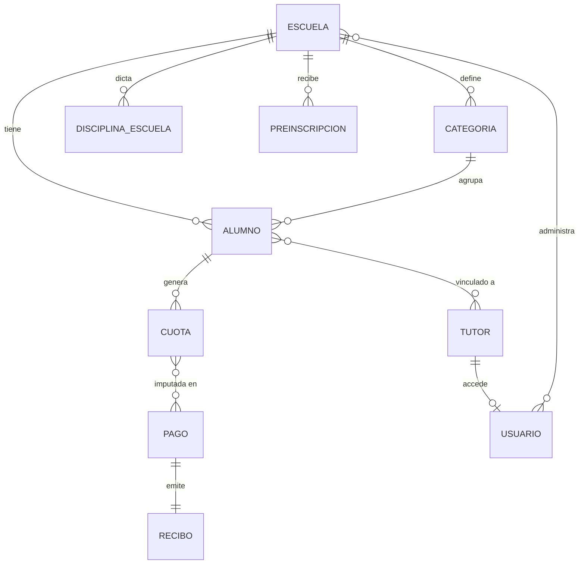

# Modelo de datos

!!! info "Pendiente"
    Se desarrollará después de validar las [reglas de negocio](../03-reglas-de-negocio/index.md): primero el modelo conceptual y luego el relacional.

## Entidades identificadas

Este diagrama es preliminar y solo muestra relaciones principales.
