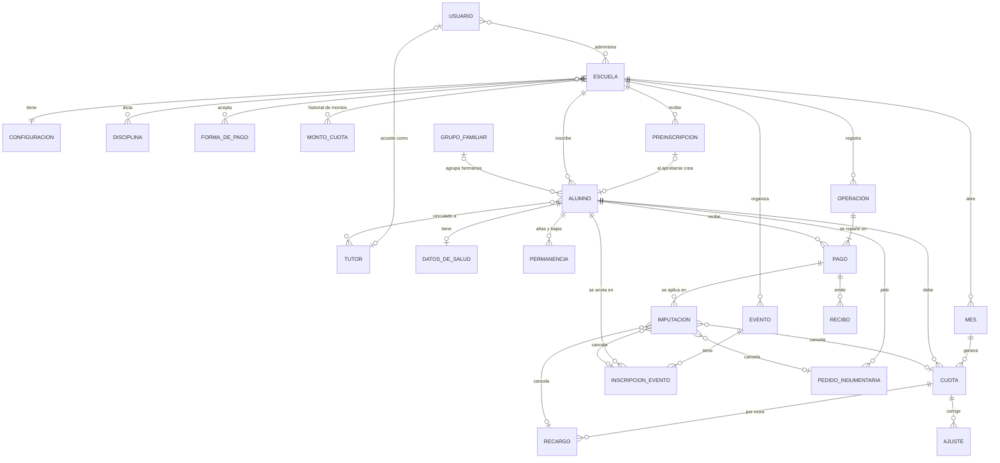

# Modelo de datos

!!! info "Modelo conceptual revisado"
    Modelo conceptual de la v1.0, revisado el 27/11/2026 a partir de las [reglas de negocio](../03-reglas-de-negocio/index.md) y de los ADR [006](../adr/0006-aislamiento-multiescuela.md) a [009](../adr/0009-numeracion-de-recibos.md). Los términos siguen el [glosario](../03-reglas-de-negocio/glosario.md). El detalle de atributos, cardinalidades y restricciones está en el [DER en notación de Chen](der.md). Próximos pasos: modelo lógico (relacional) y modelo físico.

## Principios

1. **Aislamiento por escuela.** Toda entidad con datos de una escuela pertenece a una escuela ([ADR-006](../adr/0006-aislamiento-multiescuela.md)). Escuela, usuario, tutor y disciplina son globales.
2. **Nada contable se borra.** Cuotas, recargos, inscripciones a eventos, pedidos, operaciones, pagos y recibos cambian de estado. Las correcciones son registros propios ([ADR-008](../adr/0008-historial-y-auditoria.md)).
3. **Los saldos se calculan.** El saldo de una deuda es su importe menos lo imputado; el saldo a favor de un pago es su importe menos lo imputado. No se guardan saldos que puedan desincronizarse.
4. **Los valores se congelan.** La cuota guarda el monto y el descuento vigentes; la inscripción guarda el precio del evento; el mes guarda su vencimiento y sus recargos.
5. **Conceptos separados.** Cuotas, eventos e indumentaria tienen su propia deuda y su propia recaudación ([RN-60](../03-reglas-de-negocio/eventos-e-indumentaria.md)).

## Diagrama conceptual

Por claridad, el diagrama no muestra la auditoría ni el numerador de recibos.

## Entidades

### Plataforma y escuelas

| Entidad | Qué representa | Reglas |
|---|---|---|
| Escuela | Institución que usa la plataforma. Activa o dada de baja, con fecha de baja para el plazo de anonimización. | RN-40 a RN-42 |
| Configuración | Parámetros de la escuela: logo, colores, contacto, día de vencimiento sugerido, recargos sugeridos y porcentaje de descuento por hermanos. | RN-05, RN-06, RN-08, RN-09 |
| Disciplina | Deporte. Catálogo global; cada escuela elige las suyas. | ADR-004 |
| Forma de pago | Efectivo o transferencia; cada escuela habilita las suyas. | RN-11 |
| Monto de cuota | Monto con su fecha desde. | RN-01, RN-02 |
| Usuario | Cuenta de acceso. Puede ser superadministrador, administrador de una o más escuelas, tutor, o varias cosas a la vez. Los administradores entran con su mail y los tutores con su DNI. | RN-37 a RN-47 |

La **categoría** no es una entidad: es el año de nacimiento del alumno, calculado ([RN-36](../03-reglas-de-negocio/alumnos.md)).

### Alumnos y familias

| Entidad | Qué representa | Reglas |
|---|---|---|
| Preinscripción | Solicitud recibida del formulario: pendiente, aprobada o rechazada. Al aprobarse conserva solo su estado y el alumno que generó; las rechazadas se borran a los 30 días. | RN-25 a RN-29 |
| Alumno | Persona inscripta en una escuela: DNI, nombre, apellido, fecha de nacimiento, domicilio, escuela a la que asiste y estado. | RN-26, RN-28, RN-30 a RN-36 |
| Datos de salud | Alergias, condiciones médicas y archivo del apto médico (opcional), separados del alumno para restringir el acceso. | RN-26 |
| Permanencia | Cada período entre un alta y una baja, con su motivo. | RN-31, RN-35 |
| Grupo familiar | Hermanos de una escuela, vinculados a mano por el administrador. Habilita el descuento. | RN-06 |
| Tutor | Persona adulta, global a la plataforma e identificada por su DNI: nombre, apellido, teléfono/WhatsApp, mail y un teléfono de emergencia. | RN-26, RN-29, RN-45 |
| Vínculo tutor–alumno | Qué tutores tiene cada alumno y el parentesco. | RN-48 |

### Cuotas

| Entidad | Qué representa | Reglas |
|---|---|---|
| Mes | Mes de una escuela: abierto (con monto, vencimiento y escalones de recargo), anulado o sin cobro. Registra quién lo abrió, anuló o marcó y cuándo. | RN-03 a RN-05, RN-08, RN-09, RN-61 |
| Cuota | Lo que debe un alumno por un mes abierto, con el monto y el descuento congelados. | RN-03, RN-06, RN-31 |
| Recargo | Escalón de recargo aplicado a una cuota vencida. Puede condonarse, o anularse y recalcularse si se registra un pago con fecha anterior al vencimiento. | RN-08 a RN-10, RN-62 |
| Ajuste | Cambio manual del importe de una deuda o su anulación, con valor anterior, nuevo y motivo. | RN-30, RN-33 |

### Eventos e indumentaria

| Entidad | Qué representa | Reglas |
|---|---|---|
| Evento | Torneo, campamento o viaje, con nombre, fecha, descripción y precio único. | RN-55 |
| Inscripción a evento | Alumno anotado en un evento, con el precio congelado. Puede anularse. | RN-56, RN-57, RN-60 |
| Pedido de indumentaria | Encargo de un alumno: fecha, importe y descripción opcional. Puede anularse. | RN-58 a RN-60 |

### Pagos y recibos

| Entidad | Qué representa | Reglas |
|---|---|---|
| Operación | Ingreso de dinero registrado una vez: forma de pago, importe, fecha de pago (la carga el administrador), fecha de registro, descripción opcional y si se cargó sin conexión. | RN-11, RN-12, RN-16, RN-17 |
| Pago | Parte de la operación que corresponde a un alumno y a un concepto. Lo no imputado es saldo a favor. | RN-13 a RN-18, RN-63 |
| Imputación | Aplicación de un pago a una cuota, un recargo, una inscripción a evento o un pedido. | RN-14, RN-60 |
| Recibo | Comprobante numerado por escuela, uno por pago. Si se anula, se emite otro para el mismo pago con un número nuevo. | RN-19 a RN-24, ADR-009 |
| Numerador | Último número de recibo usado por cada escuela. | ADR-009 |
| Auditoría | Registro de quién hizo qué y cuándo, incluidos los accesos en modo soporte. | RN-39, RN-43, ADR-008 |

## Cómo se recorren los casos principales

1. **Abrir el mes:** se crea el mes con monto, vencimiento y recargos, y una cuota por cada alumno activo. Cada cuota toma el descuento si el alumno tiene un hermano activo en su grupo familiar. Después se imputan los saldos a favor de cada alumno.
2. **Registrar un pago familiar:** una operación y un pago por cada alumno y concepto. En las cuotas, cada pago se imputa de la deuda más antigua a la más nueva; lo que sobra queda como saldo a favor. Se emite un recibo por pago.
3. **Vencer una cuota:** si al vencimiento la cuota tiene saldo, se crea su recargo del primer escalón. Si sigue con saldo en la fecha del segundo escalón, se crea el segundo.
4. **Cobrar un evento:** el administrador anota al alumno en el evento y registra la seña como un pago imputado a esa inscripción. El resto se paga después de la misma forma.
5. **Cargar un pago sin conexión:** la operación queda pendiente en el dispositivo. Al sincronizar, el servidor la confirma, crea los pagos, imputa y emite los recibos.
6. **Anular un pago:** el pago pasa a anulado, sus imputaciones se revierten y su recibo se anula. Si era el único pago activo de la operación, la operación también se anula.
7. **Dar de baja a un alumno:** se cierra su permanencia y el alumno pasa a inactivo. Su deuda y su saldo a favor siguen visibles, y deja de recibir cuotas.
