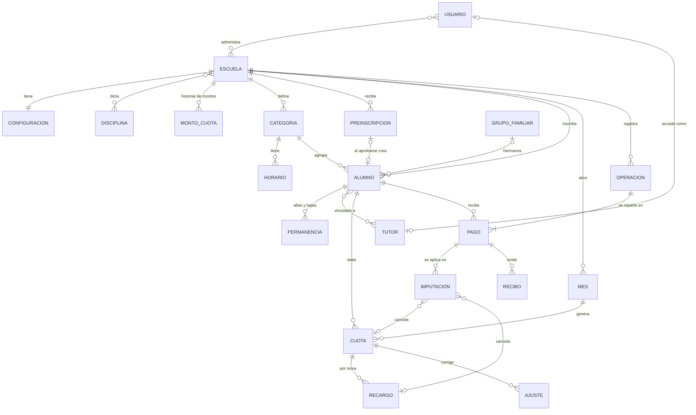

# Modelo de datos

!!! info "Borrador para revisión"
    Modelo conceptual y relacional de la v1.0, derivado de las [reglas de negocio](../03-reglas-de-negocio/index.md) y de los ADR [006](../adr/0006-aislamiento-multiescuela.md) a [009](../adr/0009-numeracion-de-recibos.md). Los términos siguen el [glosario](../03-reglas-de-negocio/glosario.md).

- **Modelo conceptual:** esta página.
- **Modelo relacional:** [tablas, claves y restricciones](relacional.md).

## Principios

1. **Aislamiento por escuela.** Toda entidad con datos de una escuela lleva su escuela ([ADR-006](../adr/0006-aislamiento-multiescuela.md)). Escuela, usuario, tutor y disciplina son globales.
2. **Nada contable se borra.** Cuotas, recargos, operaciones, pagos y recibos cambian de estado; las correcciones son registros propios ([ADR-008](../adr/0008-historial-y-auditoria.md)).
3. **Los saldos se calculan.** El saldo de una cuota es su importe menos lo imputado; el saldo a favor de un pago es su importe menos lo imputado. No se guardan saldos que puedan desincronizarse.
4. **Los valores se congelan al generarse.** La cuota guarda el monto y el descuento vigentes; el mes guarda su vencimiento y sus recargos.

## Diagrama conceptual

Por claridad, el diagrama no muestra la auditoría, los numeradores de recibos ni las tablas de configuración menores, que están en el [modelo relacional](relacional.md).

## Entidades

### Plataforma y escuelas

| Entidad | Qué representa | Reglas |
|---|---|---|
| Escuela | Institución que usa la plataforma. Activa o dada de baja, con fecha de baja para el plazo de anonimización. | RN-40 a RN-42 |
| Configuración | Parámetros de la escuela: identidad visual, día de vencimiento sugerido, recargos sugeridos, descuento por hermanos, criterio de categoría. | RN-04 a RN-11, ADR-004 |
| Disciplina | Deporte. Catálogo global; cada escuela elige las suyas. | ADR-004 |
| Monto de cuota | Monto con su fecha desde. | RN-01, RN-02 |
| Categoría y horario | Grupo de alumnos con sus días, horarios y lugar. | RN-36 |
| Usuario | Cuenta de acceso. Puede ser superadministrador, administrador de una o más escuelas, tutor, o varias cosas a la vez. | RN-37 a RN-47 |

### Alumnos y familias

| Entidad | Qué representa | Reglas |
|---|---|---|
| Preinscripción | Solicitud recibida del formulario: pendiente, aprobada o rechazada. | RN-25 a RN-29 |
| Alumno | Persona inscripta en una escuela, con su estado y su categoría. Los datos de salud van aparte, con acceso restringido. | RN-26, RN-30 a RN-36 |
| Permanencia | Cada período entre un alta y una baja. | RN-31, RN-35 |
| Grupo familiar | Agrupa a los hermanos de una escuela para el descuento. | RN-06 |
| Tutor | Persona adulta, global a la plataforma e identificada por su DNI. | RN-29, RN-45 |

### Cuotas

| Entidad | Qué representa | Reglas |
|---|---|---|
| Mes | Mes abierto por el administrador, con su monto, vencimiento y escalones de recargo. | RN-03 a RN-05, RN-08, RN-09 |
| Cuota | Lo que debe un alumno por un mes, con el monto y el descuento congelados. | RN-03, RN-06, RN-31 |
| Recargo | Escalón de recargo aplicado a una cuota vencida; puede condonarse. | RN-08 a RN-10 |
| Ajuste | Cambio manual del importe de una cuota, con valor anterior, nuevo y motivo. | RN-30, RN-33 |

### Pagos y recibos

| Entidad | Qué representa | Reglas |
|---|---|---|
| Operación | Ingreso de dinero registrado una vez: un efectivo o una transferencia. | RN-11, RN-12, RN-16 |
| Pago | Parte de la operación que corresponde a un alumno. Lo no imputado es saldo a favor. | RN-13, RN-15 a RN-18 |
| Imputación | Aplicación de un pago a una cuota o a un recargo, de la deuda más antigua a la más nueva. | RN-14 |
| Recibo | Comprobante numerado por escuela, uno por pago. Si se anula, se emite otro para el mismo pago. | RN-19 a RN-24, ADR-009 |

## Cómo se recorren los casos principales

1. **Abrir el mes:** se crea el mes con monto, vencimiento y recargos, y una cuota por cada alumno activo. Cada cuota toma el descuento si el alumno tiene un hermano activo en su grupo familiar. Después se imputan los saldos a favor de cada alumno.
2. **Registrar un pago familiar:** una operación, un pago por hermano y, por cada pago, imputaciones de la deuda más antigua a la más nueva. Lo que sobra queda como saldo a favor. Se emite un recibo por pago.
3. **Vencer una cuota:** si al vencimiento la cuota tiene saldo, se crea su recargo del primer escalón. Si sigue con saldo en la fecha del segundo escalón, se crea el segundo.
4. **Anular un pago:** el pago pasa a anulado, sus imputaciones se revierten y su recibo se anula. Si era el único pago activo de la operación, la operación también se anula.
5. **Dar de baja a un alumno:** se cierra su permanencia y el alumno pasa a inactivo. Su deuda sigue visible y deja de recibir cuotas.

## Preguntas abiertas

- ¿Un alumno con saldo a favor que se da de baja conserva ese saldo para una reincorporación, o el administrador lo devuelve y lo anula?
- Si una transferencia hecha antes del vencimiento se registra después y el recargo ya se aplicó, ¿se anula el recargo? Propuesta: el administrador lo condona con ese motivo (RN-10), sin recálculo automático.
