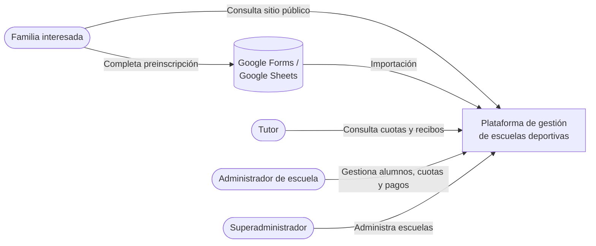

# Arquitectura

!!! info "Propuesta"
    El stack está propuesto en [ADR-007](../adr/0007-stack-tecnologico.md) y el aislamiento multiescuela en [ADR-006](../adr/0006-aislamiento-multiescuela.md).

## Stack propuesto

| Capa | Tecnología |
|---|---|
| Frontend | React, TypeScript, Vite, PWA (IndexedDB para offline) |
| Backend | Java, Spring Boot, JPA/Hibernate |
| API | REST |
| Base de datos | PostgreSQL |
| Integraciones | Google Forms / Google Sheets (preinscripción) |

## Diagrama de contexto (C4 – nivel 1)

## Temas pendientes

- Autenticación (incluida la autenticación offline).
- Sincronización y resolución de conflictos.
- Almacenamiento de archivos (logos, recibos).
- Despliegue y respaldos.
