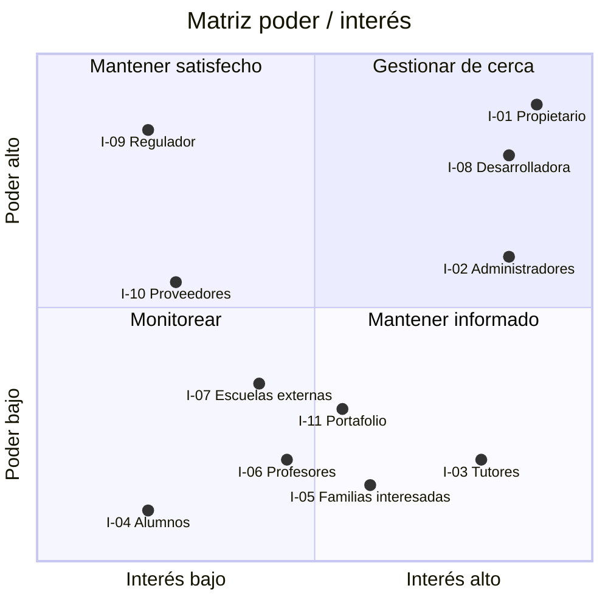

# Interesados

Los interesados (*stakeholders*) son las personas o grupos que influyen en el proyecto o que se ven afectados por él. Para cada uno se registra qué espera, cuánto poder tiene sobre las decisiones y cuánto interés tiene en el resultado. Con eso se define cómo comunicarse con cada uno.

## Registro

| ID | Interesado | Tipo | Expectativa principal | Poder | Interés | Estrategia |
|---|---|---|---|---|---|---|
| I-01 | Propietario de las escuelas (Rojas FC y las otras escuelas del mismo dueño) | Externo, cliente | Ordenar el cobro, saber la deuda real y usar un solo sistema en todas sus escuelas | Alto | Alto | Gestionar de cerca: validar reglas, alcance y entregas |
| I-02 | Administradores o coordinadores de cada escuela | Externo, usuario | Registrar pagos y alumnos rápido, sin planillas ni recibos a mano | Medio | Alto | Gestionar de cerca: pruebas de usabilidad y UAT |
| I-03 | Tutores y familias | Externo, usuario | Ver la deuda y los recibos de sus hijos sin pedirlos por WhatsApp | Bajo | Alto | Mantener informados: portal claro y avisos de cambios |
| I-04 | Alumnos | Externo, beneficiario indirecto | Que sus datos, sobre todo los de salud, estén protegidos | Bajo | Bajo | Monitorear: protección de datos de menores en todo el diseño |
| I-05 | Familias interesadas en inscribirse | Externo, usuario del sitio público | Conocer la propuesta y preinscribirse fácil | Bajo | Medio | Mantener informados: sitio público y formulario |
| I-06 | Profesores | Externo | Contar con listados de alumnos por categoría | Bajo | Medio | Monitorear: listados imprimibles; no usan el sistema en la v1.0 (RN-37) |
| I-07 | Escuelas externas (futuras clientas) | Externo, cliente potencial | Una plataforma configurable para su disciplina | Bajo | Medio | Monitorear: diseño multiescuela y multidisciplina desde el inicio |
| I-08 | Desarrolladora y responsable del producto (Marina) | Interno | Entregar un sistema profesional, mantenible y presentable como portafolio | Alto | Alto | Decide el alcance, prioriza el backlog y revisa cada cambio |
| I-09 | Agencia de Acceso a la Información Pública (controla la Ley 25.326) | Externo, regulador | Que se cumpla la ley de protección de datos personales | Alto | Bajo | Mantener satisfecho: cumplir los requisitos de dominio (RD-01 a RD-05) |
| I-10 | Proveedores (hosting, base de datos, correo y Google Forms/Sheets) | Externo | Uso dentro de sus condiciones y límites | Medio | Bajo | Monitorear: revisar planes, límites y cambios de condiciones |
| I-11 | Reclutadores y evaluadores del portafolio | Externo | Ver un proceso ordenado, documentado y con decisiones justificadas | Bajo | Medio | Mantener informados: repositorio y documentación públicos, sin datos reales |

## Matriz poder / interés

- **Gestionar de cerca:** los que tienen mucho poder y mucho interés. Participan en las decisiones y validan cada entrega.
- **Mantener satisfecho:** mucho poder y poco interés. Se cumplen sus condiciones sin cargarlos de información.
- **Mantener informado:** poco poder y mucho interés. Se les comunica el avance y los cambios que los afectan.
- **Monitorear:** poco poder y poco interés. Se revisa periódicamente si su situación cambia.
